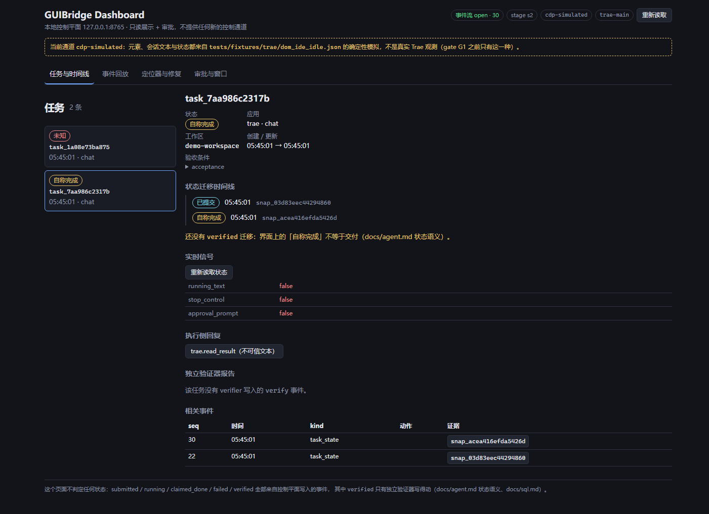
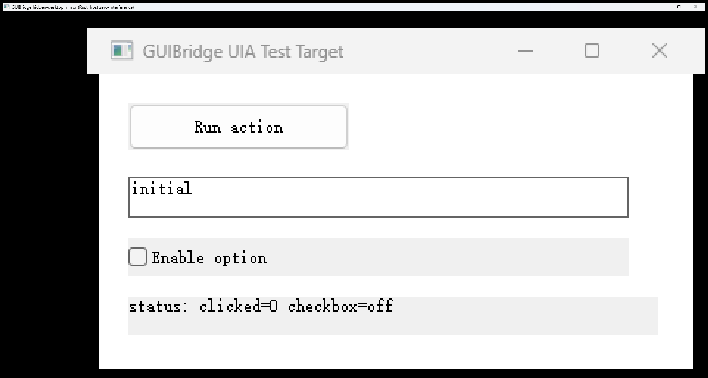

# GUIBridge

让 AI Agent 能够理解、操作并验证桌面应用。

面向 Windows 桌面应用的语义控制中间件：多通道感知 → 稳定语义定位 → 业务级 MCP 工具 → 独立验证 → 全动作审计。
让没有开放 API 的软件，成为 Agent 可以发现、调用和验证的工具——而不是靠背坐标或看屏幕乱点。

> **项目状态：实验性（development preview `v0.1.0-alpha`）**
> 模拟闭环可完整运行；隐藏桌面隔离、只读镜像与一次经授权的真实 Trae chat 发送已实测；
> 统一 live 执行链仍在集成中（控制平面 live 通道未接通）。
> **本项目目前不建议用于无人值守的生产环境。** 逐条能力状态见下表与 [docs/dev-status.md](docs/dev-status.md)。

**演示入口**：[公开展示页](https://guibridge-showcase-o66tz0jimfr.qoder.zone) —— 含可回放的模拟任务链演示、架构说明与实测数据摘要（无需安装）。
录屏视频尚未制作；展示页内的交互演示即当前完整演示入口。



## 核心能力

- **多通道语义感知**：CDP / UIA / OCR 融合为统一 `semantic_id`，冲突显式标记，不写死坐标。
- **自修复定位**：界面漂移后按旧链 hints 重扫 → 唯一候选 → 复验 → 写待审核补丁；多候选即 `conflict` 停止，不猜。
- **业务级工具面**：固定 8 个 MCP 工具（冻结契约），统一错误信封，每次调用写审计行。
- **执行安全门**：窗口白名单、身份核对、高影响动作一次性审批 token；读不到审批状态即拒绝执行。
- **独立验证**：`submitted ≠ claimed_done ≠ verified`；验证器只信 Git 变更范围与验收命令退出码，不信 Agent 自述。
- **全动作审计与回放**：SQLite 事件存储 + SSE 续传回放；Dashboard 提供时间线、定位器审核与审批授予。

## 架构



模块边界与决策记录见 [docs/architecture.md](docs/architecture.md)。

## 能力状态（模拟 / 实测 / 未验证 分开列）

| 能力 | 状态 | 证据口径 |
|------|------|----------|
| 模拟闭环 `submitted→claimed_done→verified` | ✅ 可运行 | fixture 通道 + 真实 git 变更与验收命令 |
| 非 live 自动化测试 | ✅ 569 通过 / 3 跳过 | `pytest -m "not live"`（2026-11-21 复跑） |
| 隐藏桌面隔离、主机零干扰 | ✅ 已实测 | 受控 benign 靶应用；零光标位移、不抢前台 |
| 只读镜像与点击同步 | ✅ 已实测 | Rust 原生镜像，benign 靶应用（见下图） |
| 真实 Trae chat 发送 | ✅ 实测一次 | 经授权、固定无害消息、仅 chat 模式；回复读回成功 |
| 控制平面 live 通道 | ⬜ 集成中 | `--mode live` 当前拒绝启动 |
| Trae 真实改码 live 端到端 | ⬜ 未执行 | 安全约束禁止 agent 模式 live |
| live A/B/C 基准对照 | ⬜ 未实测 | 已发布数字均为 fixture 口径，见 [docs/benchmark.md](docs/benchmark.md) |
| 录屏、跨显示器 DPI 等场景 | ⬜ 未实测 | 环境异常报 `unknown` 并停止，不盲执行 |

隐藏桌面镜像实测（benign 靶应用，live 截图；左：操作前，右：操作后，主机光标与前台窗口零干扰）：

| 操作前 | 操作后 |
|--------|--------|
|  |  |

原则：fixture 证据不等于 live 证据；没做到就不写成做到。

## 快速开始

四层入口，按目的选一层，完整步骤与成功判据见 [docs/quickstart.md](docs/quickstart.md)：

| 层 | 目的 | 入口 |
|----|------|------|
| 1 | 5 分钟模拟演示（不打开任何真实应用） | [quickstart §1](docs/quickstart.md#1-五分钟模拟演示) |
| 2 | 把 8 个工具接进 MCP 客户端 | [quickstart §2](docs/quickstart.md#2-mcp-客户端接入) |
| 3 | 开发与测试（含基准复跑） | [quickstart §3](docs/quickstart.md#3-开发与测试) |
| 4 | 实验性 live 操作（需逐条授权） | [quickstart §4](docs/quickstart.md#4-实验性-live-操作) |

最小可跑片段（Windows，Python ≥ 3.10）：

```bash
python -m venv .venv
.venv\Scripts\activate
python -m pip install -e ".[dev]"
python -m pytest -m "not live"        # 期望：569 passed / 3 skipped / 8 deselected

# 控制平面（loopback only；simulated 用 fixture 通道，不需要打开真实应用）
python apps/desktop-agent/main.py --mode simulated --db ./guibridge.sqlite3 --port 8765
```

## MCP 接入：推荐入口

- **官方推荐**：`python apps/desktop-agent/main.py --mode simulated --mcp`
  —— `packages/mcp` 冻结 8 工具面，基于 MCP SDK 2.x，stdio 传输，每次调用写审计行。
- **实验 / 兼容**：`packages/mcp_gateway`（MCP SDK 1.x FastMCP 写法，需单独环境装 `mcp<2`）。
  工具名与错误码与官方面一致；SDK 2.x 下相关用例跳过而不是伪称通过。新接入请用官方面。

stdio 客户端配置示例（路径换成你的仓库绝对路径）：

```json
{
  "mcpServers": {
    "guibridge": {
      "command": "python",
      "args": ["apps/desktop-agent/main.py", "--mode", "simulated", "--db", "./guibridge.sqlite3", "--mcp"],
      "cwd": "/path/to/guibridge"
    }
  }
}
```

工具清单、参数与错误码的冻结契约见 [docs/api.md](docs/api.md)；跨 Agent 交接语义见 [docs/agent.md](docs/agent.md)。

## 技术栈

Python · Rust · Vue 3 · TypeScript · SQLite · Windows API · CDP · UIA · OCR · MCP

## 文档索引

| 文档 | 内容 |
|------|------|
| [docs/quickstart.md](docs/quickstart.md) | 四层快速开始：前置条件、命令、成功判据 |
| [docs/architecture.md](docs/architecture.md) | 模块边界与关键决策记录 |
| [docs/api.md](docs/api.md) | MCP 8 工具 + 本地 REST/SSE 规范与错误码（冻结契约） |
| [docs/agent.md](docs/agent.md) | 跨 Agent 交接协议、状态语义、提示注入防护 |
| [docs/security.md](docs/security.md) | 安全边界：白名单/审批/CDP/隐私/环境限制，含「尚未落实」 |
| [docs/benchmark.md](docs/benchmark.md) | A/B/C 评测：fixture 模拟实测数字 + live 未实测的逐行阻塞原因 |
| [docs/dev-status.md](docs/dev-status.md) | 阶段实现状态单一事实源：出口条件逐条判定与未达成项 |
| [docs/sql.md](docs/sql.md) | SQLite 事件存储设计 |
| [docs/PRD.md](docs/PRD.md) | 产品需求：范围/路线/数据模型/状态机/安全/验收 |
| [docs/licenses.md](docs/licenses.md) | 依赖许可证审计：逐包清单、MIT 兼容结论、未覆盖项 |
| [docs/development/](docs/development/team-execution.md) | 开发协作约定与内部过程文档索引（分工、提示词、集成门、交接清单） |

## 已知限制

- 仅支持交互式 Windows 桌面会话；锁屏 / UAC 安全桌面 / 远程桌面断开 / 多显示器 DPI 变化会报 `unknown` 并停止，不盲执行。
- **模拟通道不改文件、不产截图**：离线闭环的 `verified` 证明变更范围 + 验收命令退出码 + 写入权限，不证明 GUI 真的动了手；无截图时界面显式写「无截图」。
- **基准数字是 fixture 口径**：策略排序结论成立，绝对成功率衡量的是录制快照；live 一栏逐行标了阻塞原因。
- **Dashboard 只能看和批，不能提交任务**（设计约束，不是漏做）。
- **第三方应用适配均为非官方实验性兼容**：Trae / 微信等适配器不代表相关平台授权或背书，不保证随对方版本持续可用；微信前台输入方案仅为未生效提案。公开演示一律使用 benign 靶应用。
- CDP 通道要求托管启动目标应用（仅 loopback 随机端口）。
- 隐藏桌面原生镜像/录制需要 Rust 工具链编译；无 Rust 时仅有 Python 镜像回退（功能受限）。
- 事件保留期目前只是配置项，清理调用方尚未接线。

## 目录

```text
apps/dashboard/           Vue3 + TS 展示与审批：时间线、SSE 回放、heal 审核、token 授予
apps/desktop-agent/       控制平面：REST/SSE、模拟通道、托管启动、stdio MCP 入口
packages/perception/      CDP / UIA / OCR / vision / fusion 多通道感知
packages/semantic/        数据模型 / resolver / 自修复重定位 / locator 缓存与能力表
packages/execution/       安全门 / 受限动作执行 / 独立验证器 / FocusGuard 桥接
packages/routing/         能力表路由 / 干扰策略 / 重试决策
packages/focusguard/      干扰监测、四态结果与扩展信封
packages/adapters/        第三方应用适配器（实验性、非官方兼容）
packages/events/          SQLite 事件存储（windows / tasks / events / snapshots / approvals）
packages/mcp/             官方推荐 MCP 工具面（冻结 8 工具，SDK 2.x）
packages/mcp_gateway/     实验 / 兼容 MCP 网关（SDK 1.x FastMCP）
examples/                 demo-app 与两条交接演示（控制面路径 / MCP 路径）
src/probe/                探针与后台控制实验、gbmirror（Rust 原生镜像）
tests/                    单测 + fixtures + live 集成测试（默认 deselect）+ bench
```

## 社区与许可

- 贡献指南：[CONTRIBUTING.md](CONTRIBUTING.md)（含契约冻结与测试纪律）
- 安全政策：[SECURITY.md](SECURITY.md)
- 变更记录：[CHANGELOG.md](CHANGELOG.md)
- 许可证：[MIT](LICENSE)；第三方依赖许可审计见 [docs/licenses.md](docs/licenses.md)